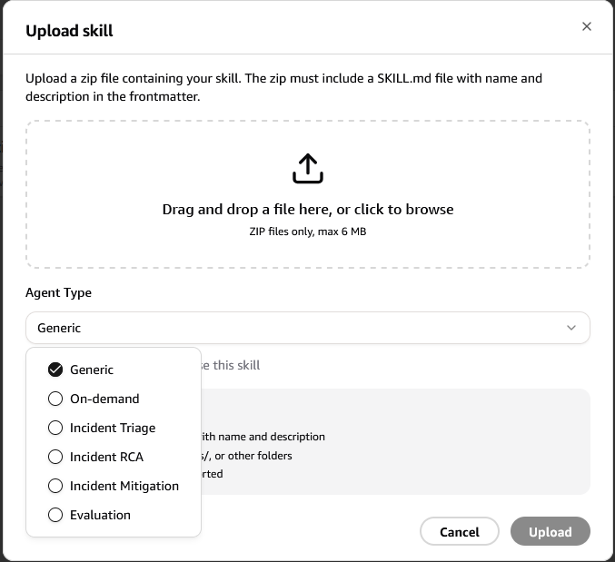
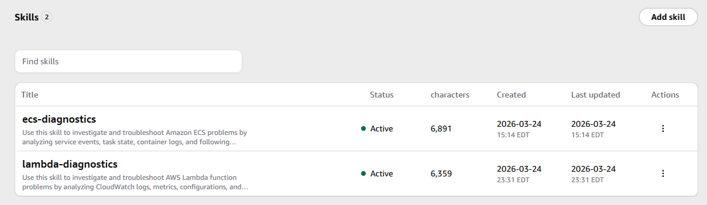
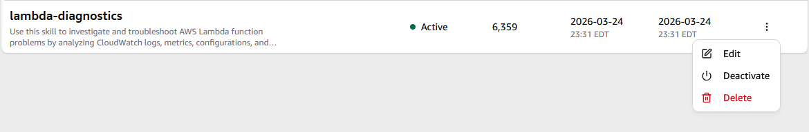

# AI Agent Troubleshooting Skills for AWS Services

A collection of 225 troubleshooting skills for AI agents working with AWS infrastructure. Each skill provides structured runbooks, anti-hallucination guardrails, and systematic investigation workflows that agents use during diagnostics.

These skills are **agent-agnostic** — they're plain markdown and YAML files that work with any AI agent or coding assistant, including AWS DevOps Agent, Kiro, Cursor, Copilot, or your own custom agent setup.

## Quick Start

### Any AI Agent

Each skill is a self-contained folder of markdown and YAML files. Clone the repo and point your agent at the relevant skill folder:

```bash
git clone https://github.com/aws-samples/sample-ai-agent-skills.git
```

Use the skill files as context for your agent — either by referencing them directly, adding them to your agent's knowledge base, or including them as steering/system context.

### AWS DevOps Agent

1. Compress the skill folder to a `.zip` file:
   ```bash
   zip -r ec2-troubleshooting.zip ec2-troubleshooting/
   ```
2. Open the AWS DevOps Agent web app
3. Go to **Settings** → **Add Skill** → **Upload Skill**
4. Select the `.zip` file and upload



The agent will automatically activate the skill when it encounters a matching problem domain.



You can always edit (customize), activate/de-activate or delete skills from the webapp.



## Available Skills

| Skill | File | Runbooks | Covers |
|-------|------|----------|--------|
| EC2 Instance Diagnostics | `ec2-troubleshooting.zip` | 42 | Status checks, connectivity, performance, storage, boot failures, networking, IAM/IMDS, state transitions, instance types, maintenance |
| ECS Container Diagnostics | `ecs-troubleshooting.zip` | 32 | Task failures, image pull, networking, IAM, deployments, performance, load balancer, capacity, exec/debug, scheduling |
| Lambda Function Diagnostics | `lambda-troubleshooting.zip` | 31 | Invocation errors, cold starts, concurrency, VPC networking, permissions, deployment, event sources, performance, observability |
| VPC Networking Diagnostics | `vpc-troubleshooting.zip` | 36 | VPC configuration, subnets, route tables, NAT, peering, Transit Gateway, endpoints, flow logs |
| S3 Diagnostics | `s3-troubleshooting.zip` | 32 | Access denied, bucket policy, encryption, replication, lifecycle, versioning, performance, events, static hosting, CORS, Object Lock |
| IAM Diagnostics | `iam-troubleshooting.zip` | 28 | Policy evaluation, role trust, cross-account, permission boundaries, SCPs, federation, credentials, MFA, service roles |
| DynamoDB Diagnostics | `dynamodb-troubleshooting.zip` | 29 | Throttling, hot partitions, GSI backpressure, query/scan, capacity, indexes, Streams, TTL, global tables, transactions, DAX |
| CloudFront Diagnostics | `cloudfront-troubleshooting.zip` | 28 | Cache issues, origin errors, SSL/TLS, performance, signed URLs, edge functions, 4xx/5xx errors, routing, logging |
| WAF & Shield Diagnostics | `waf-shield-troubleshooting.zip` | 28 | Rule evaluation, managed rules, IP/geo blocking, request inspection, logging, ALB/CF/APIGW integration, DDoS, Bot Control, ATP |
| Control Tower Diagnostics | `control-tower-troubleshooting.zip` | 32 | Landing zone, account provisioning, controls/guardrails, drift, OUs, IAM Identity Center, logging, customizations, StackSets |
| Amazon Connect Diagnostics | `connect-troubleshooting.zip` | 33 | Contact flows, call routing, agent issues, telephony, Lambda/Lex integration, chat/tasks, metrics, SSO, phone numbers |
| Aurora Diagnostics | `aurora-troubleshooting.zip` | 32 | Cluster issues, performance, connectivity, failover, replication, Serverless v2, global database, backup/backtrack, encryption, migration |
| RDS Oracle Diagnostics | `rds-oracle-troubleshooting.zip` | 27 | Instance issues, Oracle wait events, SGA/PGA, TNS/listener, parameters, backup, Data Guard Multi-AZ, Data Pump, TDE, upgrades |
| RDS SQL Server Diagnostics | `rds-sqlserver-troubleshooting.zip` | 27 | Instance issues, wait stats, tempdb, Kerberos, parameters, native backup to S3, Always On Multi-AZ, TDE, SQL audit, upgrades |
| EKS Diagnostics | `eks-troubleshooting.zip` | 31 | Cluster lifecycle, node NotReady, pod scheduling, VPC CNI/IP exhaustion, CoreDNS, ALB ingress, IRSA, aws-auth, RBAC, EBS/EFS CSI, Karpenter, HPA, add-ons, upgrades |
| CloudFormation / CDK Diagnostics | `cloudformation-troubleshooting.zip` | 28 | CREATE/UPDATE/DELETE_FAILED, UPDATE_ROLLBACK_FAILED, template errors, circular deps, drift, nested stacks, custom resources, StackSets, change sets, CDK synth/deploy |
| API Gateway Diagnostics | `apigateway-troubleshooting.zip` | 27 | Lambda integration, 4xx/5xx errors, CORS, authorizers, throttling, deployments, custom domains, WebSocket, logging, mapping templates |
| ElastiCache (Redis/Memcached) Diagnostics | `elasticache-troubleshooting.zip` | 29 | Connection failures, high CPU, evictions, memory fragmentation, replication lag, failover, cluster mode, resharding, cross-slot errors, global datastore |
| Amazon Managed Prometheus (AMP) Diagnostics | `amp-troubleshooting.zip` | 21 | Workspace issues, remote write failures, SigV4 auth, ingestion rate limiting, high cardinality, PromQL queries, alerting/ruler, ADOT/Prometheus collectors, Grafana integration |
| Amazon Managed Grafana (AMG) Diagnostics | `amg-troubleshooting.zip` | 22 | Workspace issues, SSO/SAML auth, data source connectivity (CloudWatch, AMP, OpenSearch), dashboards, alerting, plugins, VPC connectivity, API access |
| Amazon OpenSearch Service Diagnostics | `opensearch-troubleshooting.zip` | 30 | Cluster health (RED/YELLOW), JVM memory, shard management, indexing failures, search latency, storage watermarks, access policies, FGAC, snapshots, Dashboards, Serverless, ISM |
| Event-Driven (SQS/SNS/EventBridge) Diagnostics | `eventdriven-troubleshooting.zip` | 1 | DLQ, visibility timeout, FIFO ordering, SNS fanout, EventBridge rule matching, cross-account delivery, message filtering, subscription issues |
| Step Functions Diagnostics | `stepfunctions-troubleshooting.zip` | 30 | Execution failures, task timeouts, Map state parallelism, Express vs Standard, Catch/Retry, input/output processing, service integrations, history limits |
| Kinesis (Data Streams/Firehose) Diagnostics | `kinesis-troubleshooting.zip` | 30 | Shard throughput, iterator age, hot shards, enhanced fan-out, Firehose delivery failures, data transformation, KPL/KCL consumers |
| Route 53 Diagnostics | `route53-troubleshooting.zip` | 30 | DNS resolution, health checks, failover routing, weighted/latency routing, alias vs CNAME, private hosted zones, DNSSEC, domain registration |
| Secrets Manager / Parameter Store Diagnostics | `secrets-troubleshooting.zip` | 26 | Rotation failures, cross-account access, KMS dependencies, versioning, ECS/Lambda/EKS injection, Parameter Store tiers, throughput throttling |
| Cognito Diagnostics | `cognito-troubleshooting.zip` | 21 | Sign-up/sign-in failures, SAML/OIDC federation, Lambda triggers, MFA, hosted UI, user pool configuration, identity pools, token issues, adaptive auth |
| Redshift Diagnostics | `redshift-troubleshooting.zip` | 24 | Query performance, disk full, data skew, VACUUM, COPY/UNLOAD, Spectrum, WLM queues, concurrency scaling, node failures, resize, data sharing, Serverless, snapshots |
| EFS Diagnostics | `efs-troubleshooting.zip` | 16 | Mount failures, timeout, throughput limits, latency, burst credits, security groups, IAM auth, access points, lifecycle, replication, EKS/ECS integration |
| ELB (ALB/NLB/CLB) Diagnostics | `elb-troubleshooting.zip` | 0 | Target health, 502/503/504 errors, SSL/TLS, sticky sessions, cross-zone, WAF integration, access logs, connection draining, NLB TCP issues, CLB migration |
| SageMaker Diagnostics | `sagemaker-troubleshooting.zip` | 30 | Training job failures, endpoint deployment, inference errors, notebook issues, model registry, pipeline failures, spot training, VPC config, IAM permissions, resource limits |
| CI/CD Pipeline (CodePipeline/Build/Deploy) Diagnostics | `cicd-troubleshooting.zip` | 13 | Pipeline execution, source stage, CodeBuild failures/timeout/OOM, CodeDeploy rollback, artifacts, cross-account pipelines, notifications |
| MSK (Managed Kafka) Diagnostics | `msk-troubleshooting.zip` | 13 | Broker failures, producer throughput, consumer lag, under-replicated partitions, authentication (IAM/SASL/mTLS), MSK Connect, Serverless |
| AppSync Diagnostics | `appsync-troubleshooting.zip` | 19 | GraphQL resolver errors, VTL/JS resolvers, data sources (DynamoDB/Lambda/HTTP/RDS), auth modes, subscriptions, caching, N+1 queries |
| Direct Connect / VPN Diagnostics | `dx-vpn-troubleshooting.zip` | 22 | DX connection down, VIF failures, BGP sessions, VPN tunnel down, IKE negotiation, routing, failover, Transit Gateway, MACsec |
| CloudWatch Diagnostics | `cloudwatch-troubleshooting.zip` | 21 | Missing logs, retention, alarms (INSUFFICIENT_DATA), Synthetics canaries, Log Insights, Contributor Insights, cross-account, agent config |
| ACM (Certificate Manager) Diagnostics | `acm-troubleshooting.zip` | 19 | DNS/email validation, renewal failures, imported cert expiry, CloudFront us-east-1, ALB/NLB binding, private CA, import/chain errors, key algorithm |
| Glue Diagnostics | `glue-troubleshooting.zip` | 23 | Job failures, OOM (executor vs driver), crawlers, JDBC connections, Data Catalog sync, DPU sizing, shuffle/skew, bookmarks, Glue Studio |
| Transfer Family Diagnostics | `transfer-family-troubleshooting.zip` | 20 | SFTP/FTPS/FTP server issues, auth (service-managed/custom IdP), S3/EFS backends, directory mapping, host keys, passive FTP, workflows |
| App Runner Diagnostics | `apprunner-troubleshooting.zip` | 18 | Deployment/build failures, health checks, auto-scaling, custom domains, VPC connector, ECR/GitHub source, instance role, PORT config |
| AWS Backup Diagnostics | `backup-troubleshooting.zip` | 23 | Job failures, restore issues, backup plans, vault lock, cross-account/region copy, EC2/RDS/DynamoDB backup, KMS encryption, compliance |
| Elastic Beanstalk Diagnostics | `elasticbeanstalk-troubleshooting.zip` | 22 | Environment creation, deployment rollback, health red/yellow, .ebextensions, platform versions, Docker, worker tier SQS, auto-scaling |
| KMS Diagnostics | `kms-troubleshooting.zip` | 21 | Key policy evaluation, grants, cross-account keys, key state, encryption context, asymmetric/multi-region keys, S3/EBS/RDS integration, rate limits |
| Organizations Diagnostics | `organizations-troubleshooting.zip` | 20 | Account creation/closure, SCP evaluation/inheritance, OU structure, delegated admin, consolidated billing, tag/backup/AI policies, trusted access |
| Config Diagnostics | `config-troubleshooting.zip` | 19 | Rule evaluation, conformance packs, aggregators, auto-remediation, recorder config, advanced queries, organization rules, Security Hub integration |
| GuardDuty Diagnostics | `guardduty-troubleshooting.zip` | 21 | Finding analysis, false positives, S3/EKS/Lambda/RDS protection, malware scanning, runtime monitoring, threat intel, delegated admin |
| Security Hub Diagnostics | `securityhub-troubleshooting.zip` | 21 | CIS/PCI/NIST standards, finding aggregation, ASFF format, control failures, cross-account/region, automated remediation, compliance scoring |
| EventBridge Advanced (Scheduler/Pipes) Diagnostics | `eventbridge-advanced-troubleshooting.zip` | 18 | Scheduler failures, cron expressions, Pipes source-to-target, enrichment, schema registry, archive/replay, cross-account, DLQ |
| FSx Diagnostics | `fsx-troubleshooting.zip` | 23 | Lustre/Windows/ONTAP/OpenZFS, AD integration, data repository, throughput, multi-AZ failover, storage scaling, backup/restore |
| DocumentDB Diagnostics | `documentdb-troubleshooting.zip` | 20 | Cluster issues, query performance, MongoDB compatibility, TLS, change streams, global clusters, elastic clusters, index management |
| MemoryDB for Redis Diagnostics | `memorydb-troubleshooting.zip` | 17 | Cluster/node issues, ACL auth, durability vs ElastiCache, transaction log, resharding, latency, snapshot/restore |
| SSM (Systems Manager) Diagnostics | `ssm-troubleshooting.zip` | 16 | Run Command, Session Manager, Patch Manager, State Manager, Parameter Store, automation, agent issues, hybrid activation |
| Athena Diagnostics | `athena-troubleshooting.zip` | 14 | Query failures, performance, SerDe errors, partitioning, data scanned optimization, federated queries, workgroups, result location |
| Neptune Diagnostics | `neptune-troubleshooting.zip` | 18 | Cluster issues, Gremlin/SPARQL queries, bulk loading, replication, connection, performance, backup, serverless |
| Global Accelerator Diagnostics | `globalaccelerator-troubleshooting.zip` | 17 | Accelerator config, endpoint health, routing, custom routing, flow logs, cross-region, DDoS protection |
| Keyspaces (Cassandra) Diagnostics | `keyspaces-troubleshooting.zip` | 19 | Table/schema issues, CQL compatibility, throttling, TLS/SigV4 auth, TTL, PITR, Cassandra migration |
| PrivateLink Diagnostics | `privatelink-troubleshooting.zip` | 18 | Endpoint creation, DNS resolution, NLB requirements, security groups, cross-AZ, cross-account, endpoint policies |
| DMS (Database Migration) Diagnostics | `dms-troubleshooting.zip` | 21 | Task failures, CDC lag, source/target endpoints, replication instance, schema conversion, data validation, LOB handling |
| Inspector Diagnostics | `inspector-troubleshooting.zip` | 15 | EC2/ECR/Lambda scanning, findings, coverage gaps, SSM agent, Security Hub integration, multi-account |
| Macie Diagnostics | `macie-troubleshooting.zip` | 14 | Discovery jobs, classification, custom identifiers, S3 inventory, cost optimization, Security Hub |
| CloudTrail Diagnostics | `cloudtrail-troubleshooting.zip` | 19 | Trail delivery, missing events, data events, organization trail, Lake queries, Insights, log validation |
| Service Quotas Diagnostics | `servicequotas-troubleshooting.zip` | 13 | Quota lookup, increase requests, CloudWatch alarms, organization quotas, EC2/Lambda/VPC limits |
| Auto Scaling Diagnostics | `autoscaling-troubleshooting.zip` | 20 | Scaling out/in, launch failures, health checks, target tracking, step/predictive scaling, lifecycle hooks, warm pool |
| Amplify Diagnostics | `amplify-troubleshooting.zip` | 17 | Build failures, deployment, custom domains, SSR, backend environment, access control, CDN caching |
| IoT Core Diagnostics | `iotcore-troubleshooting.zip` | 18 | MQTT connectivity, certificates, rule engine, device shadow, thing registry, IoT policies, throttling |
| Amazon MQ Diagnostics | `mq-troubleshooting.zip` | 18 | Broker health, connectivity, ActiveMQ/RabbitMQ specifics, message throughput, consumer lag, upgrades |
| Batch Diagnostics | `batch-troubleshooting.zip` | 19 | Job failures, stuck RUNNABLE, compute environments, EC2/Fargate/Spot, job queues, array jobs, networking |
| DataSync Diagnostics | `datasync-troubleshooting.zip` | 17 | Task failures, agent deployment, S3/EFS/NFS locations, transfer speed, filtering, scheduling |
| Storage Gateway Diagnostics | `storagegateway-troubleshooting.zip` | 19 | Gateway deployment, file/volume/tape gateway, cache performance, NFS/SMB shares, AD integration |
| Lightsail Diagnostics | `lightsail-troubleshooting.zip` | 17 | Instance issues, static IP, firewall, managed database, containers, snapshots, load balancer, CDN |
| Verified Access Diagnostics | `verifiedaccess-troubleshooting.zip` | 16 | Trust providers, group policies, Cedar policy, endpoint connectivity, access logs, VPC config |
| Network Firewall Diagnostics | `networkfirewall-troubleshooting.zip` | 18 | Firewall deployment, stateless/stateful rules, routing, TLS inspection, alert/flow logs, Firewall Manager |
| Firewall Manager Diagnostics | `firewallmanager-troubleshooting.zip` | 16 | WAF/Shield/SG/Network Firewall/DNS Firewall policies, compliance, auto-remediation, organization |
| RAM (Resource Access Manager) Diagnostics | `ram-troubleshooting.zip` | 13 | Resource sharing, invitations, cross-account, organization sharing, managed/custom permissions |
| Lake Formation Diagnostics | `lakeformation-troubleshooting.zip` | 18 | Permissions (IAM vs LF), data location registration, column-level security, cross-account, governed tables, blueprints |
| EMR Diagnostics | `emr-troubleshooting.zip` | 22 | Cluster launch, Spark tuning, YARN, EMRFS, managed scaling, EMR on EKS, EMR Serverless, Kerberos, Studio |
| Bedrock Diagnostics | `bedrock-troubleshooting.zip` | 20 | Model access, invocation errors, knowledge bases, agents, fine-tuning, guardrails, token limits, streaming |
| Transit Gateway Diagnostics | `transitgateway-troubleshooting.zip` | 18 | TGW creation, VPC/VPN/DX attachments, route tables, peering, blackhole routes, multicast, appliance mode |
| X-Ray Diagnostics | `xray-troubleshooting.zip` | 18 | Missing/incomplete traces, sampling rules, SDK/daemon, Lambda/ECS/EKS/APIGW tracing, service map, Insights |
| Timestream Diagnostics | `timestream-troubleshooting.zip` | 15 | Table config, write failures, rejected records, query performance, memory/magnetic store, scheduled queries |
| AppStream 2.0 Diagnostics | `appstream-troubleshooting.zip` | 17 | Fleet scaling, image builder, streaming sessions, SAML, VPC config, app launch, home folders |
| WorkSpaces Diagnostics | `workspaces-troubleshooting.zip` | 17 | Provisioning, client connectivity, streaming protocol, AD integration, VPC, rebuild/restore |
| SES (Simple Email Service) Diagnostics | `ses-troubleshooting.zip` | 19 | Send failures, bounces/complaints, DKIM/SPF/DMARC, reputation, templates, sandbox, SMTP |
| Cost Explorer / Budgets Diagnostics | `costexplorer-troubleshooting.zip` | 15 | Unexpected costs, budget alerts, anomaly detection, RI/SP recommendations, CUR, organization |
| Trusted Advisor Diagnostics | `trustedadvisor-troubleshooting.zip` | 13 | Check failures, cost/security/performance, priority recommendations, EventBridge, support plan |
| Health Dashboard Diagnostics | `healthdashboard-troubleshooting.zip` | 12 | Event interpretation, affected resources, notifications, organizational health, Health API |
| MWAA (Airflow) Diagnostics | `mwaa-troubleshooting.zip` | 19 | Environment creation, DAG errors, task failures, VPC networking, worker scaling, plugins, logging |
| Proton Diagnostics | `proton-troubleshooting.zip` | 14 | Environment/service templates, provisioning, pipeline failures, template sync, Git integration |
| App Mesh Diagnostics | `appmesh-troubleshooting.zip` | 17 | Virtual nodes/services/routers, Envoy proxy, routing, mTLS, EKS integration, observability |
| Cloud Map Diagnostics | `cloudmap-troubleshooting.zip` | 13 | DNS/HTTP namespaces, service registration, health checks, ECS/EKS service discovery |
| Chatbot Diagnostics | `chatbot-troubleshooting.zip` | 11 | Slack/Teams config, SNS notifications, CLI commands in chat, IAM roles, CloudWatch/Security Hub |
| ECR Diagnostics | `ecr-troubleshooting.zip` | 17 | Push/pull failures, auth token, image scanning, lifecycle policies, replication, ECR Public |
| CodeArtifact Diagnostics | `codeartifact-troubleshooting.zip` | 14 | Repository config, auth tokens, npm/pip/Maven, publishing, upstream connections, CI/CD |
| Detective Diagnostics | `detective-troubleshooting.zip` | 14 | Behavior graph, finding investigation, entity profiles, GuardDuty/Security Hub integration |
| Incident Manager Diagnostics | `incidentmanager-troubleshooting.zip` | 14 | Response plans, escalation, contacts, automation runbooks, timeline, post-incident analysis |
| Clean Rooms Diagnostics | `cleanrooms-troubleshooting.zip` | 13 | Collaboration, configured tables, analysis rules, differential privacy, ML modeling |
| Outposts Diagnostics | `outposts-troubleshooting.zip` | 16 | Rack connectivity, EC2/ECS on Outposts, EBS/S3 local, local gateway, service link |
| Wavelength Diagnostics | `wavelength-troubleshooting.zip` | 11 | Wavelength zones, carrier gateway, carrier IP, latency, region connectivity |
| ParallelCluster Diagnostics | `parallelcluster-troubleshooting.zip` | 16 | Cluster lifecycle, Slurm scheduler, shared storage, job submission, auto-scaling, HPC |
| MediaConvert Diagnostics | `mediaconvert-troubleshooting.zip` | 16 | Job failures, codec support, output format, queue management, encoding speed, DRM |
| SNS Advanced Diagnostics | `sns-advanced-troubleshooting.zip` | 15 | Delivery status, SMS failures/spending, mobile push, filter policies, FIFO topics, cross-account |
| Pinpoint Diagnostics | `pinpoint-troubleshooting.zip` | 17 | Campaigns, segments, email/SMS/push channels, journeys, templates, analytics |
| Lex Diagnostics | `lex-troubleshooting.zip` | 17 | Bot creation, intent recognition, slot filling, Lambda fulfillment, V2, streaming |
| Rekognition Diagnostics | `rekognition-troubleshooting.zip` | 14 | Image/video analysis, face detection, custom labels, content moderation |
| Textract Diagnostics | `textract-troubleshooting.zip` | 13 | Document analysis, form/table extraction, async jobs, custom queries |
| Comprehend Diagnostics | `comprehend-troubleshooting.zip` | 13 | Entity recognition, sentiment, custom classifiers, PII detection |
| Translate Diagnostics | `translate-troubleshooting.zip` | 11 | Translation errors, custom terminology, parallel data, batch |
| Transcribe Diagnostics | `transcribe-troubleshooting.zip` | 13 | Transcription jobs, streaming, custom vocabulary, medical, call analytics |
| Personalize Diagnostics | `personalize-troubleshooting.zip` | 16 | Dataset import, solution training, campaigns, recommendations, event tracking |
| Forecast Diagnostics | `forecast-troubleshooting.zip` | 13 | Dataset import, predictor training, forecast generation, what-if analysis |
| Location Service Diagnostics | `location-troubleshooting.zip` | 13 | Maps, places, routes, geofences, trackers, device positions |
| IoT Greengrass Diagnostics | `iotgreengrass-troubleshooting.zip` | 17 | Core device, component deployment, MQTT bridge, stream manager, OTA |
| IoT SiteWise Diagnostics | `iotsitewise-troubleshooting.zip` | 14 | Asset models, measurements, portals, gateways, data ingestion |
| IoT Events Diagnostics | `iotevents-troubleshooting.zip` | 12 | Detector models, inputs, alarms, actions, state transitions |
| IoT Analytics Diagnostics | `iotanalytics-troubleshooting.zip` | 13 | Channels, pipelines, data stores, datasets, SQL queries |
| IoT TwinMaker Diagnostics | `iottwinmaker-troubleshooting.zip` | 14 | Workspace, entities, scenes, data connectors, sync jobs |
| Polly Diagnostics | `polly-troubleshooting.zip` | 12 | Speech synthesis, SSML, neural voices, lexicons, async tasks |
| HealthLake Diagnostics | `healthlake-troubleshooting.zip` | 15 | FHIR data store, import/export, search, NLP enrichment |
| QLDB Diagnostics | `qldb-troubleshooting.zip` | 15 | Ledger, PartiQL queries, journal export, verification, streaming |
| Managed Blockchain Diagnostics | `managedblockchain-troubleshooting.zip` | 13 | Hyperledger Fabric, Ethereum, chaincode, peer connectivity |
| Ground Station Diagnostics | `groundstation-troubleshooting.zip` | 12 | Satellite contacts, antenna config, data delivery, mission profiles |
| MediaLive Diagnostics | `medialive-troubleshooting.zip` | 17 | Channel creation, input config, encoding, pipeline alerts, failover |
| MediaPackage Diagnostics | `mediapackage-troubleshooting.zip` | 14 | Origin endpoints, HLS/DASH/CMAF, DRM, CDN auth, live-to-VOD |
| IVS Diagnostics | `ivs-troubleshooting.zip` | 14 | Streaming, playback, chat, recording, low-latency, real-time stages |
| Chime SDK Diagnostics | `chimesdk-troubleshooting.zip` | 14 | Meetings, audio/video, messaging, SIP media, PSTN |
| Migration Hub Diagnostics | `migrationhub-troubleshooting.zip` | 14 | Discovery, assessment, migration tracking, strategy, refactor spaces |
| Application Discovery Diagnostics | `appdiscovery-troubleshooting.zip` | 12 | Agent/agentless discovery, data collection, dependency mapping |
| Server Migration Diagnostics | `sms-troubleshooting.zip` | 12 | Replication jobs, server catalog, AMI generation, app migration |
| Mainframe Modernization Diagnostics | `mainframe-troubleshooting.zip` | 14 | Runtime environments, batch jobs, CICS/IMS, refactoring, replatforming |
| FinSpace Diagnostics | `finspace-troubleshooting.zip` | 12 | Environments, datasets, managed kdb, permissions, changesets |
| DataZone Diagnostics | `datazone-troubleshooting.zip` | 14 | Domains, projects, data assets, subscriptions, governance, catalog |
| Panorama Diagnostics | `panorama-troubleshooting.zip` | 12 | Device provisioning, app deployment, model compilation, camera streams |
| RoboMaker Diagnostics | `robomaker-troubleshooting.zip` | 15 | Simulation jobs, robot apps, fleet management, ROS, world generation |
| Kendra Diagnostics | `kendra-troubleshooting.zip` | 17 | Index creation, data source sync, query relevance, FAQ, ACL |
| Q Business Diagnostics | `qbusiness-troubleshooting.zip` | 14 | Application, data source connectors, retrieval, guardrails, plugins |
| Q Developer Diagnostics | `qdeveloper-troubleshooting.zip` | 12 | Code suggestions, security scanning, code transformation, IDE integration |
| CodeGuru Diagnostics | `codeguru-troubleshooting.zip` | 14 | Reviewer, profiler, security detector, repository association |
| DevOps Guru Diagnostics | `devopsguru-troubleshooting.zip` | 15 | Insights, anomaly detection, resource coverage, cost estimation |
| Compute Optimizer Diagnostics | `computeoptimizer-troubleshooting.zip` | 12 | EC2/Lambda/EBS/ECS recommendations, enrollment, export |
| Well-Architected Tool Diagnostics | `wellarchitected-troubleshooting.zip` | 12 | Workload reviews, lenses, improvement plans, milestones, custom lenses |
| Elastic Disaster Recovery Diagnostics | `drs-troubleshooting.zip` | 17 | Source server, replication, recovery, failback, drill testing |
| Application Migration Service Diagnostics | `mgn-troubleshooting.zip` | 15 | Source server, replication, cutover, post-migration, agent |
| Resilience Hub Diagnostics | `resiliencehub-troubleshooting.zip` | 15 | Application, resiliency policy, assessment, recommendations, drift |
| Fault Injection Service Diagnostics | `fis-troubleshooting.zip` | 14 | Experiment templates, targets, actions, stop conditions, execution |
| Change Manager Diagnostics | `changemanager-troubleshooting.zip` | 12 | Change templates, requests, approvals, runbook execution |
| OpsCenter Diagnostics | `opscenter-troubleshooting.zip` | 12 | OpsItems, automation, related resources, deduplication |
| Audit Manager Diagnostics | `auditmanager-troubleshooting.zip` | 14 | Assessments, frameworks, controls, evidence collection, reports |
| IAM Access Analyzer Diagnostics | `accessanalyzer-troubleshooting.zip` | 15 | Findings, external/unused access, policy validation/generation |
| Migration Hub Orchestrator Diagnostics | `migrationorchestrator-troubleshooting.zip` | 12 | Workflow templates, step execution, SAP/SQL Server migration |
| Control Catalog Diagnostics | `controlcatalog-troubleshooting.zip` | 12 | Control listing, details, objectives, common controls, regional availability |
| RDS MySQL Diagnostics | `rds-mysql-troubleshooting.zip` | 15 | Instance issues, InnoDB, slow queries, replication lag, Multi-AZ, parameter groups, backup, upgrades |
| RDS PostgreSQL Diagnostics | `rds-postgresql-troubleshooting.zip` | 14 | Instance issues, vacuum/bloat, query performance, replication, extensions, parameter groups, upgrades |
| RDS MariaDB Diagnostics | `rds-mariadb-troubleshooting.zip` | 8 | Instance issues, InnoDB, replication, parameter groups, backup, upgrades |
| CloudHSM Diagnostics | `cloudhsm-troubleshooting.zip` | 0 | Cluster creation, HSM provisioning, client connectivity, key management, HA, CloudHSM SDK |
| Entity Resolution Diagnostics | `entityresolution-troubleshooting.zip` | 12 | Matching workflows, schema mapping, rule-based/ML matching, output configuration, data quality |
| Glue DataBrew Diagnostics | `gluedatabrew-troubleshooting.zip` | 13 | Project creation, recipe jobs, profile jobs, dataset issues, transformations, output format |
| Security Lake Diagnostics | `securitylake-troubleshooting.zip` | 17 | Data lake creation, log sources, subscribers, query access, OCSF schema, cross-account |
| Verified Permissions Diagnostics | `verifiedpermissions-troubleshooting.zip` | 13 | Policy store, Cedar policies, authorization decisions, schema, identity source, token validation |
| VPC Lattice Diagnostics | `vpclattice-troubleshooting.zip` | 17 | Service network, services, target groups, listeners, routing, auth policies, cross-account |
| AppConfig Diagnostics | `appconfig-troubleshooting.zip` | 14 | Configuration deployments, feature flags, validation errors, deployment strategies, extensions, Lambda/ECS integration, rollback triggers |
| CloudShell Diagnostics | `cloudshell-troubleshooting.zip` | 12 | Session launch, environment persistence, network connectivity, VPC environments, storage, file transfer, permissions, timeouts |
| Service Catalog Diagnostics | `servicecatalog-troubleshooting.zip` | 14 | Portfolio creation/sharing, product provisioning, launch/template constraints, provisioned products, tag options, organization sharing, Terraform products |
| GameLift Diagnostics | `gamelift-troubleshooting.zip` | 14 | Fleet creation/scaling, game session placement, matchmaking, build upload, server process crashes, health checks, Realtime Servers, FlexMatch, Spot fleets |
| Elastic Transcoder Diagnostics | `elastictranscoder-troubleshooting.zip` | 12 | Pipeline creation, job failures, presets, input/output format errors, notifications, permissions, watermarks/thumbnails |
| WorkDocs Diagnostics | `workdocs-troubleshooting.zip` | 12 | Site creation, directory integration, upload/download, sync client, sharing permissions, collaboration, user management, migration, storage limits |
| WorkMail Diagnostics | `workmail-troubleshooting.zip` | 12 | Organization creation, domain verification, email delivery/receiving, client connectivity, mobile sync, mailbox issues, Exchange migration, journaling |
| Braket Diagnostics | `braket-troubleshooting.zip` | 12 | Quantum task failures, simulator errors, hardware device issues, circuit validation, hybrid jobs, notebook instances, SDK errors, device availability |
| HealthImaging Diagnostics | `healthimaging-troubleshooting.zip` | 12 | Datastore creation, DICOM import/validation, image set retrieval, metadata queries, copy jobs, deletion, access control, encryption |
| Supply Chain Diagnostics | `supplychain-troubleshooting.zip` | 12 | Instance creation, data integration, data lake, demand/supply planning, inventory visibility, insights, connectors, S3 integration |
| Payment Cryptography Diagnostics | `paymentcryptography-troubleshooting.zip` | 14 | Key creation/import/export, encryption/decryption, PIN operations, MAC verification, key aliases, audit logging, PCI compliance, key rotation |
| Private 5G Diagnostics | `private5g-troubleshooting.zip` | 12 | Network creation, network sites, radio unit activation, device connectivity, SIM provisioning, throughput, coverage, VPC integration |
| Wickr Diagnostics | `wickr-troubleshooting.zip` | 12 | Network creation, admin console, user provisioning, SSO, message delivery, file sharing, retention policies, compliance logging, bot integration, federation |
| CodeCatalyst Diagnostics | `codecatalyst-troubleshooting.zip` | 14 | Space/project creation, workflow failures, action errors, dev environments, IDE connectivity, source repos, deployments, AWS connection, IAM roles, blueprints |
| SSM Automation Advanced Diagnostics | `ssm-automation-troubleshooting.zip` | 14 | Automation execution, step errors, document creation/versioning, approval workflows, rate control, cross-account/multi-region, change calendar, maintenance windows |
| Chatbot Advanced Diagnostics | `chatbot-advanced-troubleshooting.zip` | 12 | Custom actions, action approvals, Teams integration, guardrails, notification filtering, run command from chat, Lambda from chat, cross-account, event patterns |
| Entity Resolution Advanced Diagnostics | `entityresolution-advanced-troubleshooting.zip` | 12 | Matching/ID mapping workflows, schema mapping, provider services, rule-based/ML matching, output configuration, data quality, privacy, Glue integration |
| MediaConnect Diagnostics | `mediaconnect-troubleshooting.zip` | 14 | Flow creation, source connectivity/failover, output delivery, entitlements, VPC interfaces, encryption, transport streams, bandwidth, multi-region flows |
| AppFlow Diagnostics | `appflow-troubleshooting.zip` | 14 | Flow creation, connector profiles, Salesforce/SaaS connectors, data mapping, scheduling, S3/Redshift destinations, custom connectors, PrivateLink |
| Snow Family Diagnostics | `snowfamily-troubleshooting.zip` | 14 | Snowball/Snowball Edge/Snowcone, device ordering/unlock, data transfer, NFS shares, edge compute, EC2 on Snow, S3 adapter, clustering, OTA updates |
| Managed Apache Flink Diagnostics | `managed-flink-troubleshooting.zip` | 14 | Application creation/start, Flink job failures, checkpoints, source/sink connectors, scaling, parallelism, state management, watermarks, Studio notebooks |
| S3 Object Lambda Diagnostics | `s3-objectlambda-troubleshooting.zip` | 12 | Access point creation, Lambda invocation, transformation failures, permissions, performance, timeout, range/head requests, CloudFront integration |
| Edge Functions (CloudFront/Lambda@Edge) Diagnostics | `edge-functions-troubleshooting.zip` | 14 | CloudFront Functions, Lambda@Edge, viewer/origin request/response, function publish, replication, timeout, memory, testing, cache behavior association |
| ECS Anywhere Diagnostics | `ecs-anywhere-troubleshooting.zip` | 12 | External instance registration, SSM agent, task placement, container runtime, networking, service discovery, IAM roles, monitoring, capacity provider |
| EKS Anywhere Diagnostics | `eks-anywhere-troubleshooting.zip` | 14 | Cluster creation/upgrade, node provisioning, vSphere/bare metal providers, Cilium networking, curated packages, Flux GitOps, IAM authenticator, backup/restore |
| Data Exchange Diagnostics | `dataexchange-troubleshooting.zip` | 12 | Dataset creation, revision publishing, subscriptions, entitlements, S3 exports, API assets, Redshift/Lake Formation access, provider/subscriber management |
| IoT Device Defender Diagnostics | `iot-device-defender-troubleshooting.zip` | 12 | Audit configuration, audit findings, security profiles, metric anomalies, mitigation actions, custom metrics, ML Detect, fleet indexing integration |
| IoT Device Management Diagnostics | `iot-device-management-troubleshooting.zip` | 12 | Fleet provisioning, bulk registration, IoT jobs, secure tunneling, thing groups/types, fleet indexing, device shadows, OTA updates |
| IoT FleetWise Diagnostics | `iot-fleetwise-troubleshooting.zip` | 12 | Fleet/vehicle management, decoder manifests, signal catalogs, campaigns, data collection, edge agent, S3/Timestream destinations |
| Nitro Enclaves Diagnostics | `nitro-enclaves-troubleshooting.zip` | 12 | Enclave creation, EIF image builds, vsock communication, KMS integration, attestation, memory/CPU allocation, ACM integration, parent instance |
| Bottlerocket Diagnostics | `bottlerocket-troubleshooting.zip` | 12 | AMI launch, updates (A/B partitions), ECS/EKS agent, admin/control containers, networking, storage, settings API, bootstrap, security hardening |
| Elastic Fabric Adapter (EFA) Diagnostics | `efa-troubleshooting.zip` | 12 | EFA creation/attachment, driver installation, libfabric, MPI communication, NCCL, performance, bandwidth, security groups, placement groups, SageMaker |
| MediaStore Diagnostics | `mediastore-troubleshooting.zip` | 12 | Container creation, container policies, put/get object, CORS, lifecycle policies, access logging, metric policies, CDN integration, throttling |
| MediaTailor Diagnostics | `mediatailor-troubleshooting.zip` | 12 | Playback configuration, ad insertion, VAST responses, channel assembly, source locations, CDN config, manifest manipulation, prefetch schedules |
| Local Zones Diagnostics | `localzones-troubleshooting.zip` | 12 | Zone enablement, subnet creation, instance launch, instance type availability, EBS volumes, networking, ELB/RDS integration, latency testing |
| Deadline Cloud Diagnostics | `deadline-cloud-troubleshooting.zip` | 14 | Farm creation, fleet configuration, queues, job submission, worker agent, worker hosts, storage profiles, job attachments, budgets, license endpoints |
| Clean Rooms ML Diagnostics | `cleanrooms-ml-troubleshooting.zip` | 12 | Training models, configured models, audience generation, lookalike models, privacy budgets, seed audiences, S3 data access, differential privacy |
| Monitron Diagnostics | `monitron-troubleshooting.zip` | 12 | Project creation, gateway setup, sensor pairing, sensor data gaps, inference anomalies, false positives, gateway connectivity, WiFi, mobile app |
| Lookout for Vision Diagnostics | `lookout-vision-troubleshooting.zip` | 12 | Project creation, dataset import, model training/evaluation, inference, edge deployment, image quality, labeling, model packaging, Greengrass |
| Lookout for Equipment Diagnostics | `lookout-equipment-troubleshooting.zip` | 12 | Dataset creation, data ingestion, model training/evaluation, inference scheduler, labels, retraining policy, S3 access, data quality |
| Lookout for Metrics Diagnostics | `lookout-metrics-troubleshooting.zip` | 12 | Detector creation/activation, dataset configuration, data source connectivity, anomaly detection, false positives, alerting, S3/CloudWatch/Redshift sources |
| Control Tower AFT Diagnostics | `controltower-aft-troubleshooting.zip` | 14 | AFT deployment, pipeline errors, account requests, customizations, Terraform state, CodePipeline/CodeBuild, SSO integration, VPC config, upgrades |
| Landing Zone Accelerator Diagnostics | `lza-troubleshooting.zip` | 14 | Installation, pipeline execution, config files (accounts/org/network/security/global/customizations), CDK synth, CloudFormation stacks, upgrades, drift |
| Outposts Servers Diagnostics | `outposts-servers-troubleshooting.zip` | 12 | Server ordering, activation, EC2 launch, EBS local volumes, network/CoIP, service link, capacity, software updates, rack-vs-server differences |
| Verified Access Advanced Diagnostics | `verified-access-advanced-troubleshooting.zip` | 12 | Instance creation, trust providers, Cedar policy debugging, policy evaluation, endpoint groups, device/user trust, access logs, WAF integration |
| Mainframe Modernization Advanced Diagnostics | `mainframe-advanced-troubleshooting.zip` | 12 | Blu Age refactoring, Micro Focus replatforming, deployment, runtime environments, batch jobs (JCL), CICS transactions, data migration, hybrid connectivity |
| Application Composer Diagnostics | `application-composer-troubleshooting.zip` | 12 | Project sync, template import, resource configuration, SAM/CloudFormation templates, local development, IDE extension, deployment, custom resource cards |
| Resource Explorer Diagnostics | `resource-explorer-troubleshooting.zip` | 12 | Index creation, aggregator index, search queries, missing resources, views, filter expressions, cross-region indexing, organization integration |
| Backup Gateway Diagnostics | `backup-gateway-troubleshooting.zip` | 12 | Gateway deployment, gateway connectivity, hypervisor/vCenter connection, VM discovery, VM backup, restore, bandwidth throttling, maintenance |
| Network Manager (Cloud WAN) Diagnostics | `network-manager-troubleshooting.zip` | 14 | Global network, core network policy, attachments, peering, route analysis, routing policies, segments, TGW registration, telemetry, policy versions |
| VPN Advanced Diagnostics | `vpn-advanced-troubleshooting.zip` | 12 | Accelerated VPN, ECMP, certificate-based auth, private IP VPN, CloudWatch monitoring, log analysis, BGP propagation, static route failover, DPD timeout |
| CloudWatch Internet Monitor Diagnostics | `internetmonitor-troubleshooting.zip` | 12 | Monitor creation, health events, availability scores, traffic insights, city-network analysis, CloudFront/VPC integration, log delivery, thresholds |
| CloudWatch Evidently Diagnostics | `evidently-troubleshooting.zip` | 12 | Project creation, feature flags, feature evaluation, launch scheduling, A/B experiments, experiment results, segments, metric definitions, S3 export |
| CloudWatch RUM Diagnostics | `rum-troubleshooting.zip` | 12 | App monitor creation, data collection, JavaScript snippet, custom events, page performance, session replay, user journeys, Cognito integration |
| SSM Fleet Manager Diagnostics | `ssm-fleet-manager-troubleshooting.zip` | 12 | Managed node registration, remote desktop, file system access, performance counters, hybrid activation, IAM instance profile, SSM agent connectivity |
| Route 53 Resolver Diagnostics | `route53-resolver-troubleshooting.zip` | 14 | Resolver endpoints, forwarding rules, DNS Firewall rule groups/domain lists, query logging, inbound/outbound endpoints, RAM sharing, DNSSEC validation |
| AWS Signer Diagnostics | `signer-troubleshooting.zip` | 12 | Signing profiles, signing jobs, signature validation, Lambda code signing, IoT code signing, platforms, certificates, cross-account signing |
| AWS Marketplace Diagnostics | `marketplace-troubleshooting.zip` | 14 | Subscriptions, SaaS/AMI/container/data products, seller registration, product listing, metering, entitlements, private marketplace, vendor insights |
| License Manager Diagnostics | `license-manager-troubleshooting.zip` | 12 | License configurations, rule violations, grants, host resource groups, dedicated hosts, Linux/user subscriptions, cross-account sharing, automated discovery |
| Budgets Actions Diagnostics | `budgets-actions-troubleshooting.zip` | 12 | Budget creation, alerts, action execution, IAM policy/SCP/EC2/RDS actions, approval workflows, thresholds, notifications, organization budgets |
| Elemental Link Diagnostics | `elemental-link-troubleshooting.zip` | 12 | Device registration, connectivity, input configuration, video quality, HDMI/SDI, MediaLive integration, firmware updates, multi-device management |
| WorkSpaces Web Diagnostics | `workspaces-web-troubleshooting.zip` | 12 | Portal creation, browser sessions, session connectivity, IdP/SAML auth, network/VPC settings, browser policies, user access logging, IP access settings |
| Connect Analytics (Contact Lens/Wisdom) Diagnostics | `connect-analytics-troubleshooting.zip` | 14 | Contact Lens enablement, real-time analytics, sentiment analysis, transcription, category rules, Wisdom knowledge bases, evaluation forms, screen recording |
| SSM Distributor Diagnostics | `ssm-distributor-troubleshooting.zip` | 12 | Package creation, installation/uninstallation, association execution, cross-platform packages, S3 storage, third-party packages |
| CloudWatch Application Signals Diagnostics | `cloudwatch-application-signals-troubleshooting.zip` | 12 | Service discovery, instrumentation, SLO creation/evaluation, dependency mapping, metric collection, trace/log correlation, EKS/EC2 integration |
| VPC IPAM Diagnostics | `vpc-ipam-troubleshooting.zip` | 12 | IPAM creation, scopes, pool CIDR provisioning, allocation failures, overlap detection, organization integration, cross-region, BYOIP, public IP insights |

## What Each Skill Contains

Every skill follows the same structure:

```
<service>-troubleshooting/
├── SKILL.md                    # Main skill definition, investigation workflow, gotchas, anti-hallucination rules
├── README.md                   # Skill documentation
└── references/
    ├── A1-<topic>.md           # Runbook A1
    ├── A2-<topic>.md           # Runbook A2
    ├── ...                     # More runbooks organized by category
    ├── Z1-general-troubleshooting.md   # Catch-all runbook
    ├── <service>-guardrails.md         # Anti-misdiagnosis guardrails
    └── <service>-hallucination-patterns.yaml  # Common LLM mistakes
```

### SKILL.md

The main file the agent reads first. Contains:
- When to activate the skill (trigger conditions)
- Step-by-step investigation workflow with real AWS CLI commands
- Service-specific gotchas and behavioral nuances
- Anti-hallucination rules to prevent common misdiagnosis

### Runbooks

Each runbook is a structured SOP for a specific failure mode:
- Phase 1 — Triage (MUST/SHOULD/MAY with CLI commands)
- Phase 2 — Remediate (MUST/SHOULD/MAY actions)
- Safety Ratings (GREEN/YELLOW/RED classification for every remediation action)
- Escalation Conditions (when the agent must stop and ask a human)
- Data Sensitivity (which triage commands return sensitive data, classified HIGH/MEDIUM/LOW)
- Prohibited Actions (service-specific NEVER rules to prevent dangerous fixes)
- Phase 3 — Rollback (revert guidance for state-changing actions)
- Common Issues (symptoms → diagnosis → resolution)
- Output Format (structured YAML for consistent reporting)

### Safety Ratings

Every Phase 2 remediation action is classified:

| Rating | Description | Examples |
|--------|-------------|----------|
| GREEN | Read-only, no state changes | `describe-*`, `get-*`, `list-*`, `kubectl get` |
| YELLOW | State-changing but recoverable | Modify security group, update parameter, restart service |
| RED | Destructive or irreversible | Delete resource, terminate instance, modify key policy |

### Escalation Conditions

Each runbook defines when the agent must stop and escalate to a human. Common triggers:
- Remediation requires modifying IAM policies in a production account
- Remediation requires disabling a security control even temporarily
- Root cause cannot be identified after 3 hypothesis pivots
- Blast radius affects more than one account or region
- Issue involves potential data loss or exposure

### Data Sensitivity

Triage commands are classified by the sensitivity of data they return:
- HIGH: Full IAM policies, key policies, account IDs, aws-auth ConfigMap, credentials, GuardDuty findings
- MEDIUM: Resource ARNs, VPC configurations, parameter settings, service quotas
- LOW: Resource status, CloudWatch metrics (aggregated), error messages, configuration settings

Each runbook tags its triage commands with the appropriate sensitivity level so the agent knows what to redact from stored output.

### Prohibited Actions

Service-specific rules the agent must never suggest as remediation. Examples:
- IAM: NEVER suggest `Action: *` or `Resource: *` in any policy fix
- S3: NEVER suggest disabling Block Public Access as a remediation
- EKS: NEVER suggest `system:masters` group for troubleshooting access
- KMS: NEVER suggest `kms:*` on a key policy
- Networking: NEVER suggest `0.0.0.0/0` inbound rules as a fix

See [SECURITY.md](SECURITY.md) for the full global prohibited actions list. Each runbook also includes service-specific prohibited actions.

### Guardrails

Rules the agent checks before concluding on any issue. Prevents misdiagnosis from common assumptions that don't hold true for the specific service.

### Hallucination Patterns

Documented patterns where LLMs commonly produce incorrect information about the service. Each pattern includes the wrong claim, the actual behavior, and the correct action.

## Skill Categories

### Compute
- EC2, ECS, Lambda, EKS, Auto Scaling, Batch, Lightsail, ParallelCluster, Outposts, Outposts Servers, Wavelength, Ground Station, GameLift, Private 5G, ECS Anywhere, EKS Anywhere, Local Zones, Bottlerocket, Nitro Enclaves, Elastic Fabric Adapter (EFA), Deadline Cloud

### Networking & Content Delivery
- VPC, VPC IPAM, CloudFront, API Gateway, Route 53, Route 53 Resolver (DNS Firewall), ELB (ALB/NLB/CLB), Direct Connect / VPN, VPN Advanced, Global Accelerator, PrivateLink, Network Firewall, Transit Gateway, App Mesh, Cloud Map, VPC Lattice, Network Manager (Cloud WAN), Edge Functions (CloudFront Functions/Lambda@Edge), S3 Object Lambda

### Security & Identity
- IAM, WAF & Shield, Secrets Manager / Parameter Store, Cognito, ACM, KMS, GuardDuty, Security Hub, Inspector, Macie, Firewall Manager, Verified Access, Verified Access Advanced, Detective, Audit Manager, IAM Access Analyzer, CloudHSM, Security Lake, Verified Permissions, Payment Cryptography, Wickr, AWS Signer

### Storage
- S3, EFS, FSx (Lustre/Windows/ONTAP/OpenZFS), Storage Gateway, DataSync, Snow Family (Snowball/Snowball Edge/Snowcone), MediaStore

### Database
- DynamoDB, Aurora, RDS Oracle, RDS SQL Server, RDS MySQL, RDS PostgreSQL, RDS MariaDB, ElastiCache, Redshift, DocumentDB, MemoryDB, Neptune, Keyspaces, Timestream, QLDB, Managed Blockchain, Entity Resolution Advanced

### Analytics & Observability
- Amazon OpenSearch Service, Amazon Managed Prometheus, Amazon Managed Grafana, CloudWatch, CloudWatch Internet Monitor, CloudWatch Evidently, CloudWatch RUM, CloudWatch Application Signals, Athena, Lake Formation, EMR, X-Ray, Timestream, Clean Rooms, Clean Rooms ML, DataZone, FinSpace, Lookout for Metrics, Managed Apache Flink

### Application Integration
- SQS / SNS / EventBridge, Step Functions, Kinesis, AppSync, EventBridge Advanced (Scheduler/Pipes), Amazon MQ, IoT Core, SNS Advanced, IoT Greengrass, IoT SiteWise, IoT Events, IoT Analytics, IoT TwinMaker, IoT Device Defender, IoT Device Management, IoT FleetWise, Location Service, AppFlow

### Management & Governance
- Control Tower, Control Tower AFT, Landing Zone Accelerator, CloudFormation / CDK, Organizations, Config, CloudWatch, SSM (Systems Manager), SSM Automation Advanced, SSM Fleet Manager, SSM Distributor, CloudTrail, Service Quotas, RAM, Trusted Advisor, Health Dashboard, Incident Manager, Cost Explorer / Budgets, Budgets Actions, Change Manager, OpsCenter, DevOps Guru, Compute Optimizer, Well-Architected Tool, Resilience Hub, Fault Injection Service, AppConfig, CloudShell, Service Catalog, Resource Explorer, License Manager

### Developer Tools
- CI/CD Pipeline (CodePipeline / CodeBuild / CodeDeploy), ECR, CodeArtifact, Proton, CodeGuru, Q Developer, CodeCatalyst

### Data Integration
- Glue, DMS (Database Migration Service), Glue DataBrew, Supply Chain, Data Exchange, Data Pipeline (legacy)

### Migration & Transfer
- Transfer Family, AWS Backup, Backup Gateway, Elastic Disaster Recovery, Application Migration Service, Migration Hub, Migration Hub Orchestrator, Application Discovery, Server Migration, Mainframe Modernization, Mainframe Modernization Advanced

### Machine Learning & AI
- SageMaker, Bedrock, Rekognition, Textract, Comprehend, Translate, Transcribe, Polly, Personalize, Forecast, Lex, Kendra, Q Business, Q Developer, Panorama, RoboMaker, HealthLake, HealthImaging, Braket (Quantum), Lookout for Vision, Lookout for Equipment, Monitron, DeepRacer

### Streaming & Media
- MSK (Managed Kafka), MediaConvert, MediaLive, MediaPackage, IVS (Interactive Video), Chime SDK, Elastic Transcoder, MediaConnect, MediaStore, MediaTailor, Elemental Link

### Containers & Serverless
- App Runner, Elastic Beanstalk, Amplify, Application Composer

### End User Computing
- AppStream 2.0, WorkSpaces, WorkSpaces Web

### Customer Engagement
- Amazon Connect, Connect Analytics (Contact Lens/Wisdom), SES, Chatbot, Chatbot Advanced, Pinpoint, SNS Advanced, WorkDocs, WorkMail, AWS Marketplace

### Workflow Orchestration
- MWAA (Apache Airflow)

## Contributing

To create a new skill following the same pattern:

1. Create a directory named `<service>-troubleshooting/`
2. Add `SKILL.md` with frontmatter, investigation workflow, gotchas, and anti-hallucination rules
3. Add `README.md` with skill documentation
4. Create `references/` with runbooks (A1, A2, ..., Z1), guardrails, and hallucination patterns

For AWS DevOps Agent, zip the directory before uploading:
```bash
zip -r <service>-troubleshooting.zip <service>-troubleshooting/
```

Each runbook should follow the standard format with YAML frontmatter (including `version: "1.0.0"`), Phase 1 Triage, Phase 2 Remediate (with safety ratings), Phase 3 Rollback (for state-changing actions), Common Issues, Escalation Conditions, and Output Format sections. See [SECURITY.md](SECURITY.md) for the full security framework.

## Multi-Cloud Skills

In addition to the 225 AWS skills above, this collection includes troubleshooting skills for other major cloud providers:

### Oracle Cloud Infrastructure (OCI) — 20 skills
Located in `oracle-cloud/`. Covers: Compute, Networking (VCN), Object Storage, Database (Autonomous DB, Exadata, Data Guard), IAM, Kubernetes (OKE), Functions, Load Balancer, Block Storage, Monitoring, Container Engine/OCIR, API Gateway, Streaming, Notifications, Events, File Storage, WAF, DNS, Email Delivery, Data Integration. Uses `oci` CLI commands.

### Google Cloud Platform (GCP) — 20 skills
Located in `gcp-cloud/`. Covers: Compute Engine, GKE, Cloud SQL, Cloud Storage, Cloud Run, BigQuery, Cloud IAM, VPC Networking, Cloud Functions, Cloud Monitoring, Pub/Sub, Dataflow, Spanner, Memorystore, Cloud Armor, Cloud CDN, Artifact Registry, Cloud Build, Dataproc, Vertex AI. Uses `gcloud` CLI commands.

### Microsoft Azure — 20 skills
Located in `azure-cloud/`. Covers: Virtual Machines, AKS, Azure SQL, Azure Storage, Azure Functions, Networking, Entra ID, Cosmos DB, Azure DevOps, Azure Monitor, Key Vault, Container Registry, Service Bus, Event Hubs, Logic Apps, App Service, Front Door, Synapse Analytics, Databricks, Defender for Cloud. Uses `az` CLI commands.

Each cloud folder has its own README.md with a skills table and usage instructions.

## Security

This collection includes a comprehensive [SECURITY.md](SECURITY.md) framework covering:
- Prohibited actions (global rules the agent must never suggest)
- Safety classification system (GREEN/YELLOW/RED for all remediation actions)
- Escalation conditions (when the agent must stop and ask a human)
- Data sensitivity classifications (what to redact from investigation output)
- Rollback guidance requirements
- Remediation hallucination patterns (overly broad fixes that create security holes)
- Cleanup guidance for temporary resources
- Production deployment recommendations

Skills are reference resources for demonstration purposes. They contain no executable code but influence AI agent behavior against live infrastructure. See SECURITY.md for the full threat model and mitigations.

## Author

Ravikumar Sola ([solair@amazon.com](mailto:solair@amazon.com))

## License

MIT License

Copyright (c) 2025 Ravikumar Sola

Permission is hereby granted, free of charge, to any person obtaining a copy
of this software and associated documentation files (the "Software"), to deal
in the Software without restriction, including without limitation the rights
to use, copy, modify, merge, publish, distribute, sublicense, and/or sell
copies of the Software, and to permit persons to whom the Software is
furnished to do so, subject to the following conditions:

The above copyright notice and this permission notice shall be included in all
copies or substantial portions of the Software.

THE SOFTWARE IS PROVIDED "AS IS", WITHOUT WARRANTY OF ANY KIND, EXPRESS OR
IMPLIED, INCLUDING BUT NOT LIMITED TO THE WARRANTIES OF MERCHANTABILITY,
FITNESS FOR A PARTICULAR PURPOSE AND NONINFRINGEMENT. IN NO EVENT SHALL THE
AUTHORS OR COPYRIGHT HOLDERS BE LIABLE FOR ANY CLAIM, DAMAGES OR OTHER
LIABILITY, WHETHER IN AN ACTION OF CONTRACT, TORT OR OTHERWISE, ARISING FROM,
OUT OF OR IN CONNECTION WITH THE SOFTWARE OR THE USE OR OTHER DEALINGS IN THE
SOFTWARE.
